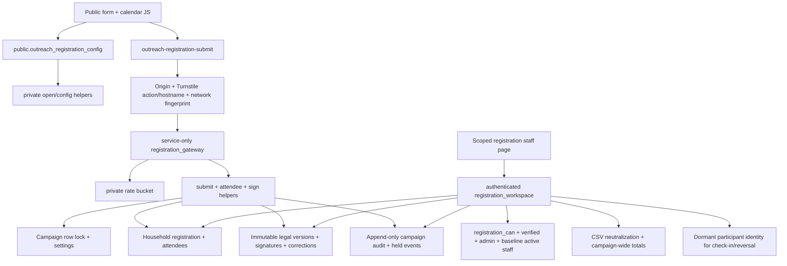

# Huntsville minimal dependency graph

This release branch is reconciled onto current production main `f0d6fe9e07140dab6ed829ed5ccfdbb7af12e2fd`, preserving its Bessemer mobile-only change unchanged. The validated minimal slice originated from prior production main `a9c8a73c228866749831f0df4236295c3791216f`, not PR #24 ancestry. Accepted Huntsville reference: `dba68735cd68ddfc00ddbc16109a01e2794027dc`.

## Exact inventory and statement review

- [Required objects](HUNTSVILLE-REQUIRED-OBJECTS.json) contains every new table, column, implicit/explicit index, constraint, trigger and function definition; origins; baseline hash manifest; ACLs; before/after counts; and dependency edges.
- [Inherited statements](HUNTSVILLE-INHERITED-STATEMENTS.json) classifies all 405 top-level statements across all ten post-production migrations at the accepted source. SHA-256 plus file/statement/line permits exact source lookup. DO blocks are classified as a unit; no old seed block is executed. Mixed statements are extracted/narrowed as described, not replayed.
- [Source manifest](HUNTSVILLE-SOURCE-MANIFEST.json) records exact app/function hashes versus accepted source. Private runtime evidence is outside the repository and publish artifact.

The disposable catalog adds **14 tables, 160 columns, 22 functions, 41 indexes, four immutable triggers, zero views and zero raw-table policies**. Its 255 constraints include PostgreSQL catalog not-null constraints (counts differ on server versions that represent not-null metadata differently). All required column definitions, nullability/defaults and constraints are in the machine inventory. No existing table, function, index, constraint, trigger, policy or view is changed.

## Runtime graph

## Required table families

| Objects | Origin | Required purpose / isolation |
|---|---|---|
| outreach_campaigns | Phase A core | Canonical ownership, dates, venue, status and lock target. Workflow template/opportunity columns/FKs removed. No generic campaign workspace RPC. |
| outreach_campaign_admins; outreach_campaign_assignments | Phase A core + Phase C registration capabilities | Explicit active/dated authority. Only view, registration.view/manage/export and checkin.manage accepted. No actual users granted. Role labels alone confer no access. |
| outreach_campaign_registrants | Phase A core | Dormant composite FK target retained for accepted attendee/participant identity compatibility; no import, bridge RPC, Person creation or legacy writes. |
| outreach_campaign_audit; outreach_campaign_events | Phase A core + Phase C events | Append-only audited actions and seven registration/check-in events held without delivery. No notification worker. |
| outreach_prize_participants | Phase A prize integrity + Phase C attendee FK | Required because accepted check-in/reversal directly creates/reuses/updates this identity. Only dormant identity; no drawing numbers/pools/selections/claims. |
| outreach_registration_settings | Phase C + Huntsville extension | Public window, capacity, requiredness, structured address and event profile. Created disabled. |
| outreach_event_registrations; outreach_event_attendees | Phase C + Huntsville extension | Canonical household submission, explicit attendees, age counts, separate individual check-in, idempotency, contact/emergency fields. |
| outreach_waiver_versions; outreach_waiver_signatures; outreach_waiver_corrections | Phase C + Huntsville extension | Exact versioned legal/media text, signature/initials/server timestamp, coverage snapshot and append-only correction. |
| private.outreach_registration_rate | Phase C | Gateway network rate buckets, independent of Person/email matching. |

Columns retained within these canonical tables preserve accepted row shapes and identity integrity, even where a field is dormant for this event. This is the smallest **behavior-preserving object slice**, not a destructive redesign of accepted record types. All later-phase tables and operational RPCs are absent.

## Existing production dependencies (unchanged)

- `auth.uid`: Existing platform auth role/API Origins: Supabase platform Auth schema/API.
- `auth.users`: Existing platform auth role/API Origins: Supabase platform Auth schema/API.
- `private.staff_assignment_active`: Existing organization/person integrity or active-staff helper; no modifications. Origins: `20260928172557_people_staff_v1.sql`.
- `public.households`: Existing organization/person integrity or active-staff helper; no modifications. Origins: `20260926024742_household_records.sql`.
- `public.organization_people`: Existing organization/person integrity or active-staff helper; no modifications. Origins: `20260925200310_organization_foundation.sql`, `20260926000821_followup_tasks.sql`, `20260928172557_people_staff_v1.sql`.
- `public.organizations`: Existing organization/person integrity or active-staff helper; no modifications. Origins: `20260925200310_organization_foundation.sql`.
- `public.outreach_registrations`: Existing organization/person integrity or active-staff helper; no modifications. Origins: `20260923121707_add_st_lucia_registration_and_account_linking.sql`, `20260925200318_harden_outreach_claim.sql`.

The baseline already supplies `auth.users` identity/confirmation, `auth.uid()`, organizations and composite household/Person keys. `private.staff_assignment_active` uses the existing organization staff assignment model. No broader staff-workspace, Giving or communications schema is necessary.

## Exact functions

- `private.outreach_admin(p_org uuid, p_manage boolean)` — 20261006113255_outreach_campaign_core_v1.sql.
- `private.outreach_audit(p_campaign uuid, p_org uuid, p_kind text, p_subject uuid, p_meta jsonb)` — 20261006113255_outreach_campaign_core_v1.sql.
- `private.outreach_csv_cell(p_value text)` — 20261006113255_outreach_campaign_core_v1.sql.
- `private.outreach_event(p_campaign uuid, p_kind text, p_subject uuid, p_key text)` — 20261006113255_outreach_campaign_core_v1.sql.
- `private.outreach_immutable()` — 20261006113255_outreach_campaign_core_v1.sql.
- `private.outreach_registration_address(p jsonb, required boolean)` — 20261016165316_huntsville_registration_release_candidate.sql.
- `private.outreach_registration_answers(c uuid, answers jsonb)` — 20261007073021_outreach_phase_c_registration_checkin.sql.
- `private.outreach_registration_attendee(c uuid, r uuid, p jsonb)` — 20261007073021_outreach_phase_c_registration_checkin.sql.
- `private.outreach_registration_can(c uuid, cap text)` — 20261007073021_outreach_phase_c_registration_checkin.sql.
- `private.outreach_registration_config(c uuid)` — 20261007073021_outreach_phase_c_registration_checkin.sql, 20261016165316_huntsville_registration_release_candidate.sql.
- `private.outreach_registration_coverage(c uuid, a uuid)` — 20261007073021_outreach_phase_c_registration_checkin.sql.
- `private.outreach_registration_detail(c uuid, r uuid)` — 20261007073021_outreach_phase_c_registration_checkin.sql.
- `private.outreach_registration_gateway(slug text, p jsonb, network text)` — 20261007073021_outreach_phase_c_registration_checkin.sql.
- `private.outreach_registration_open(c uuid)` — 20261007073021_outreach_phase_c_registration_checkin.sql.
- `private.outreach_registration_public_config(slug text)` — 20261007073021_outreach_phase_c_registration_checkin.sql.
- `private.outreach_registration_sign(c uuid, r uuid, p jsonb)` — 20261007073021_outreach_phase_c_registration_checkin.sql, 20261016165316_huntsville_registration_release_candidate.sql.
- `private.outreach_registration_submit(c uuid, p jsonb, mode text)` — 20261007073021_outreach_phase_c_registration_checkin.sql, 20261016165316_huntsville_registration_release_candidate.sql.
- `private.outreach_registration_workspace(action text, c uuid, p jsonb)` — 20261007073021_outreach_phase_c_registration_checkin.sql, 20261016165316_huntsville_registration_release_candidate.sql.
- `private.outreach_verified(p_user uuid)` — 20261006113255_outreach_campaign_core_v1.sql.
- `public.outreach_registration_config(p_slug text)` — 20261007073021_outreach_phase_c_registration_checkin.sql.
- `public.outreach_registration_gateway(p_slug text, p_payload jsonb, p_network text)` — 20261007073021_outreach_phase_c_registration_checkin.sql.
- `public.outreach_registration_workspace(p_action text, p_campaign uuid, p_payload jsonb)` — 20261007073021_outreach_phase_c_registration_checkin.sql.

`registration_workspace` uses the latest accepted Huntsville body plus one narrow `assignments` read action. That action requires both registration.manage and campaign administrator authority. It replaces the UI dependency on the unrelated broad `outreach_campaign_workspace`; it cannot create an assignment. Existing registration access edits retain reviewed-reason and optimistic-revision requirements. Two focused checks verify administrator success and ordinary registration-manager denial.

## RLS, grants and audit

All 14 new tables have RLS enabled and raw PUBLIC/anon/authenticated access revoked. No permissive table policy is introduced. Private helper EXECUTE is revoked from PUBLIC/anon/authenticated; security-definer helpers use an empty search_path and schema-qualified references. Existing baseline ACLs are asserted unchanged.

- anon: public registration config only.
- authenticated: public config; public/private registration workspace entry points (recheck active authority on every action, including after waiting for the campaign row lock).
- service_role: public/private registration gateway plus server-side table privileges; the Edge Function protects this entry with exact origins, Turnstile and rate controls. No service key enters browser assets.
- Four immutable triggers protect campaign audit, legal versions, signatures and corrections. Seven domain-event kinds remain held; no sending machinery exists in this slice.
- CSV is campaign-scoped, permission checked and formula-neutralized. It excludes internal signature content and idempotency secrets. Totals derive from active canonical attendee rows, exclude inactive/cancelled/no-show/closed registrations, and do not change with search.

## Migration classification totals

- REQUIRED FOR HUNTSVILLE: 73 statements.
- UNRELATED: 56 statements.
- OPTIONAL / NOT REQUIRED: 3 statements.
- SEED / ENVIRONMENT DATA: 5 statements.
- BESSEMER-SPECIFIC: 2 statements.
- LATER-PHASE FUNCTIONALITY: 266 statements.

Phase A workflow is excluded in full, including both Bessemer-related seed/import blocks. Phase B travel/team, Phase D drawing operations, Phase E command center/template cloning and Phase F tasks/files are excluded in full. Phase A opportunities, contacts, sources, decisions, follow-ups, template engine and broad campaign RPCs are excluded. Historical Huntsville existing-draft patch is replaced with guarded fresh draft creation.

## Application slice

- `outreach-register.html`: exact accepted bytes.
- `staff-outreach-registration.html`: narrow adaptation described below.
- `assets/css/outreach-campaigns.css`: exact accepted bytes.
- `assets/css/outreach-registration.css`: exact accepted bytes.
- `assets/js/outreach-registration-form.js`: exact accepted bytes.
- `assets/js/outreach-registration-public.js`: exact accepted bytes.
- `assets/js/outreach-registration-staff.js`: narrow adaptation described below.
- `config/outreach/huntsville-2026.json`: exact accepted bytes.
- `tools/site-build/public-files.json`: narrow adaptation described below.
- `supabase/functions/outreach-registration-submit/index.ts`: exact accepted bytes.
- `supabase/functions/outreach-registration-submit/gateway.mjs`: exact accepted bytes.

Staff HTML uses a small registration-only navigation shell, not the unpublished shared staff shell. Its fallback returns to production's existing `staff-people.html`. Staff JS reads assignments through the registration RPC. The public manifest adds only seven runtime HTML/CSS/JS files; config, tests, docs and migrations remain non-public. Existing public pages, giving links, `/go`, St Lucia, Auth config, Netlify configuration and shared gateway fingerprint helper remain unchanged. The current live Bessemer mobile registration-flow change from production main is preserved byte-for-byte in this release branch.

The public form, legal config, form/calendar module, public handler and two Edge Function files match accepted bytes. Current main's `outreach-staff-common.js` and `outreach-partner-submit/gateway.mjs` are also byte-identical to accepted source and are reused unchanged.
