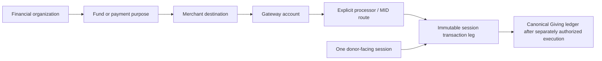

## GIV-3D provider-neutral operational extension

The GIV-3D sibling starts at exact accepted GIV-3A; no provider-specific files are ported. Operations consume normalized outputs and canonical sessions/legs/requests/journals. Safe lookup observations never post a ledger; unknown outcomes stay locked, approvals are distinct from held execution, and stale charge leases require lookup rather than recharge. No actual provider/credential/runtime activation. See [GIV-3D](GIVING-GIV-3D-PAYMENT-OPERATIONS.md) and [runbook](PAYMENT-OPERATIONS-RUNBOOK.md). GIV-3B/3C remain unchanged; NMI hosted acceptance remains paused only for credentials.

# Payment-provider architecture — GIV-3A

GIV-3A is a disabled build foundation. This document describes implemented boundaries, not a claim that NMI/Authorize.Net boarding, vault portability or sandbox integration has been verified.

## Ownership and routing

Each canonical reference is owner-scoped. Brand/UI origin does not decide the financial owner. Fund tree rollups remain independent from merchant accounts. A line must resolve exactly one currency/environment-compatible destination/account/route; currency is never silently converted. Snapshots freeze fund/destination/account/route versions and amount boundaries. Consolidation requires the same owner/destination/account/MID and allowed capability. Historical pre-GIV-3A Form purpose derives from its original immutable submission version without rewriting accepted lines; every new native/Form line has explicit purpose. A canonical session can hold several independently failing legs; receipts summarize those legs without claiming full success after partial failure.

| Model | Account / route representation | Token boundary |
|---|---|---|
| NMI | One account with Main/Youth/Outreach/Events/Merch route metadata | Explicit account/environment/compatible-route binding; no vault portability claim |
| Authorize.Net | Separate gateway accounts and their routes | Separate account/customer/payment references; tokens never presumed portable |
| Manual / future | Same neutral contract and explicit metadata | No implicit token execution or fallback |

## Logical method and secret separation

A masked logical donor method can map to multiple private provider payment profiles and route compatibility rows. Customers are account/environment/owner/person scoped. Repeated synthetic attachment must retain identical identity/descriptor/route scope. Provider refs are synthetic only in this build; method registration and provider tokenization widgets are disabled. Reviewed Giving donor-account ownership is independent of general portal ownership. No PAN/CVV/bank number appears in a schema field, browser payload or log mechanism.

Private credential references follow `payments/<organization>/<gateway>/<sandbox|live>/v<version>`. The database contains only scoped reference/version/webhook metadata; the server-only runtime resolver checks the exact tuple before fetching a secret from runtime storage. Status projection exposes Configured/Missing/Invalid/Held, environment and last verification, never values. No secrets are configured by GIV-3A.

## Gate and idempotency order

1. Resolve current verified actor and financial owner; acquire canonical per-organization lock.
2. Validate exact minor units, deterministic currency/environment route, current immutable Form version and original intent.
3. Bind checkout or operation idempotency to full content; create one canonical session or operation.
4. Claim one execution lease and recheck all current relevant switches, authority, capability, token and session constraints.
5. GIV-3A stage remains false and runtime holds even forged all-true gate projections. No adapter transport exists. The old finalizer is barred for native/Form sources.
6. A future approved adapter must resolve credentials server-side, journal a safe attempt, reconcile unknown outcomes and promote canonical Giving outcomes only after provider verification. Never blindly retry an uncertain charge or assume authorization means settlement.

All switches default held: global, organization, gateway, MID route and Form/checkout. Separate payment keys do not imply activation; the empty elevated authority registry and a later explicit release are additional requirements. Activation attempts are audited and never enable this stage.

## Lifecycle

The neutral operation contract includes tokenization/customer/method, auth/capture/sale, full/partial refund/void, recurring and retrieval. Refund/void metadata binds the original leg and canonical request. Canonical recurring instructions retain donor intent and multiple fund lines; provider profile IDs are scoped implementation refs. One instruction/due time has one held job. No real subscription, automatic charge or SMS command is created.

Safe provider journals contain operation, digest/idempotency, route, timestamps, normalized status/reference. Sensitive response bodies are not stored. Fixed normalized failures include declined, insufficient_funds, invalid_payment_method, expired_card, processor_unavailable, fraud_review, routing_error, configuration_error, duplicate and unknown. Unknown/timeout requires review and does not trigger automatic retry. Outcomes are all_success, partial_success, all_failed or pending_review.

The undeployed webhook HTTP boundary fails closed before body parsing when a real verifier is absent. A future signature verifier must operate over bounded original bytes and bind provider/account/environment/leg before dedupe. Current service-only synthetic fixtures preserve one normalized event and held reconciliation; no financial posting. Disputed/chargeback status is a future integration hook. Settlement fee/net remains unknown when not supplied; no estimated financial truth is invented.

Receipts are previews of one canonical session, its date/reference/exact totals, lines, contribution/non-contribution classification and selected masked method or honest unselected state. No receipt or statement is sent. Event fees and merchandise share the checkout/ledger architecture but remain non-gifts. Future Text-to-Give can resolve keyword → fund → destination → gateway → MID → compatible logical method, while channel credit accounting stays an independent organization hook. It is not live.

## Exposure and next boundary

Browser RPCs are narrow, current-permission/owner scoped. New private tables have RLS and revoked raw access; private helpers have explicit least-privilege grants and empty search paths. Views omit token/customer refs, secrets and full MID references. The shared Staff Workspace shell adds permission-filtered native provider/routing/method/transaction pages, preserving existing finance and ministry modules. Public static artifacts exclude SQL, server modules, test adapters, audit and documents.

GIV-3B is actual NMI multi-MID adapter and separately authorized sandbox acceptance. GIV-3C is separately authorized Authorize.Net integration. Both require vendor-specific token portability, credentials, callbacks, signature, idempotency and reconciliation evidence; neither started here. Live activation, production cutover and GiveHub migration remain distinct gates.

Implementation/test details: [GIV-3A build contract](GIVING-GIV-3A-PROVIDER-FOUNDATION.md). Supabase reference baseline: [RLS](https://supabase.com/docs/guides/database/postgres/row-level-security), [runtime secrets](https://supabase.com/docs/guides/functions/secrets). No hosted advisor or migration run is implied; local schema/RLS tests cover the new relations and RPC boundary.
